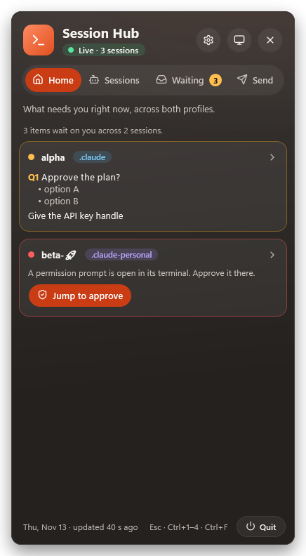
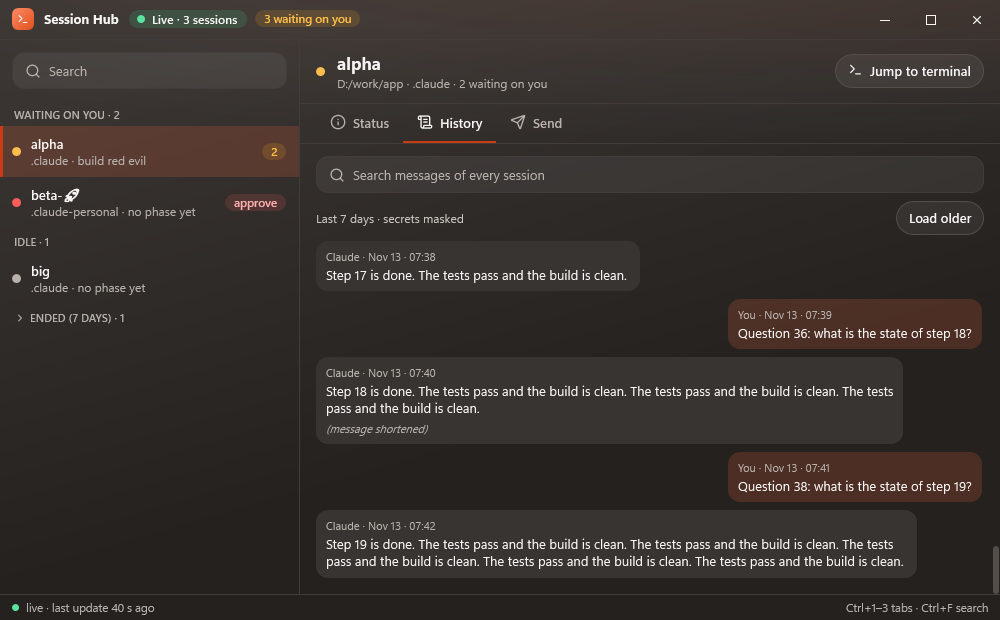
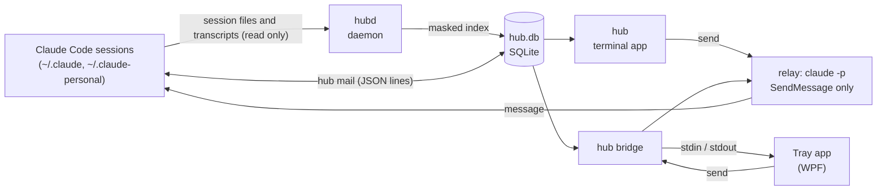
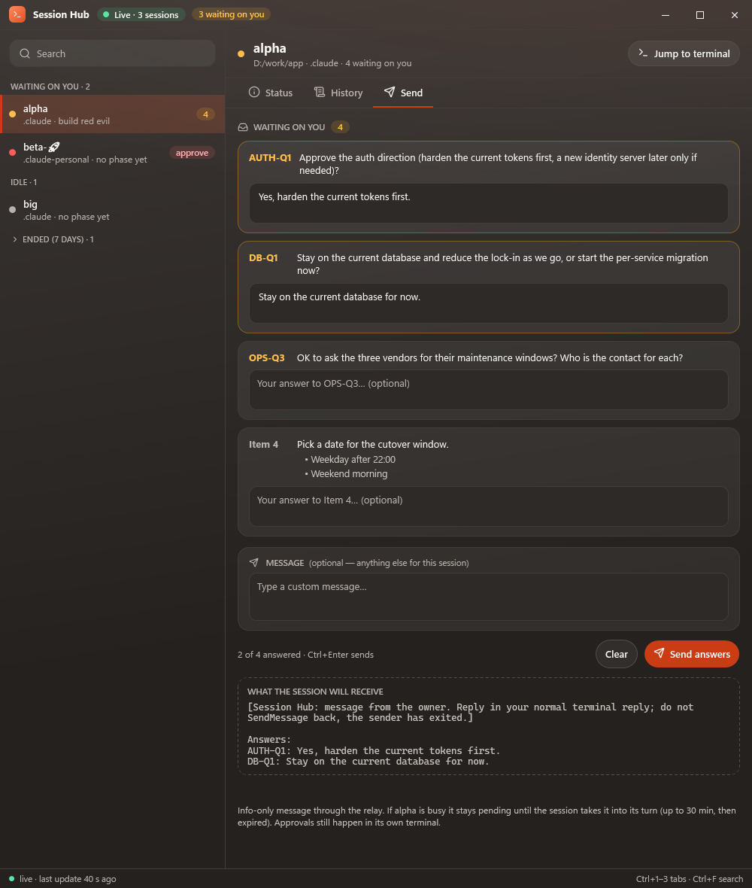

<h1 align="center">Session Hub</h1>

<p align="center">
  <strong>One place to see every Claude Code session on your Windows PC, and to answer the ones waiting on you.</strong>
</p>

<p align="center">
  <a href="https://github.com/ravindu0823/session-hub/actions/workflows/ci.yml"></a>
  <a href="LICENSE"></a>
  
  
  
</p>

<p align="center">
  
  &nbsp;&nbsp;
  
</p>

When you run several Claude Code sessions at once, it is easy to miss the one that has been waiting on you for
twenty minutes. Session Hub watches the sessions on this machine and shows, in one terminal app and one tray icon:

- **What needs you now.** Each session's latest *Progress*, *What's remaining* and *Waiting on you* sections, with the
  questions listed one by one.
- **Who is busy, idle or blocked.** Live state per session, including sessions stuck on a permission prompt.
- **What was said.** The last 7 days of each session's history, searchable, with secrets masked.
- **A way to reply.** Type answers next to each question, or a free message, and send it to that session.
- **A way to approve.** Approvals never go through the hub: one click jumps to the session's own terminal.

Everything runs locally. Session Hub opens no network port and reads only Claude Code's own session files.

## Contents

- [How it works](#how-it-works)
- [Requirements](#requirements)
- [Install](#install)
- [Use it](#use-it): [terminal app](#terminal-app) · [tray app](#tray-app) · [sending a message](#sending-a-message) ·
  [mail between sessions](#mail-between-sessions)
- [Security and privacy](#security-and-privacy)
- [Data and retention](#data-and-retention)
- [Troubleshooting](#troubleshooting)
- [Development](#development)
- [License](#license)

## How it works



- **`hubd`** (the daemon) tails each session's transcript from where it left off, extracts the status sections, masks
  secrets and writes a SQLite index. It starts at login.
- **`hub`** is the terminal app and the command line. **The tray app** gets the same data through a `hub bridge`
  child process over stdin and stdout.
- **Sending** runs one fixed `claude -p` relay that can only call `SendMessage`. Delivery counts only when the exact
  text (SHA-256) shows up in the recipient's own transcript.
- **Mail** goes between sessions through `hub.db` itself, addressed by role, with no model in between
  ([mail between sessions](#mail-between-sessions)).

## Requirements

| Needs | Version |
| --- | --- |
| OS | Windows 11 |
| Runtime | .NET 10 Desktop Runtime (the tray app is a framework-dependent single file) |
| Claude Code | tested with 2.1.323; profiles read: `~/.claude` and `~/.claude-personal` |
| To build | Bun 1.4.2 and .NET SDK 10.0.404 (pinned in `global.json`) |

## Install

```powershell
bun install --frozen-lockfile --ignore-scripts
bun run build
dist\hub.exe install
```

That is all. `hub install` copies the three programs to `%LOCALAPPDATA%\SessionHub\bin\`, adds a `hub` command,
starts the daemon and the tray, and sets both to start at login. Or run `scripts\install.ps1`, which builds and
installs in one step from a clean, pushed `main`.

To remove it:

```powershell
hub uninstall               # quits the tray, clears autostart, stops the daemon, removes the hub command and the data
hub uninstall --keep-data   # the same, but keeps the data directory
```

<details>
<summary><strong>What the build and install do, in detail</strong></summary>

`bun run build` produces three executables: `hub.exe` (every command, including the TUI), `hubd.exe` (the daemon only,
built without a console window) and `SessionHubTray.exe` (the tray app, published from `gui/SessionHub.Tray`).
`hub install` copies all three to `%LOCALAPPDATA%\SessionHub\bin\`, writes a `hub.cmd` shim to
`%USERPROFILE%\.local\bin` (already on PATH), creates the private data directory, sets two HKCU Run values with no
arguments (`SessionHubDaemon` = `"%LOCALAPPDATA%\SessionHub\bin\hubd.exe"`, `SessionHubTray` =
`"%LOCALAPPDATA%\SessionHub\bin\SessionHubTray.exe"`), then starts the daemon and the tray. It never edits PATH, and it
refuses to install if a foreign `hub.cmd` already exists in that folder.

**Verified builds.** `bun run build` also writes `dist\install-manifest.txt`: the commit it built from (marked `dirty`
when the tree had uncommitted changes) and the SHA-256 of each exe. `hub install` refuses exes that do not match it,
and a `dirty` build unless it gets `--allow-unreviewed`. It stages and checks all three copies before it replaces any
exe, puts the old exes back if a replace fails part-way, prints the commit, and keeps the manifest in `bin\` so the
installed build can be traced. `scripts\install.ps1` builds and installs in one step, and only from a clean tree on
`main` whose HEAD is already on `origin/main`, unless it gets `-AllowUnreviewed`.

**Replacing a running install.** A running tray is asked to quit first (it saves typed drafts), so `hub install` can
replace the exes. If it has not exited after 5 s it is stopped by force, but only when `run\tray.pid` names a process
running `bin\SessionHubTray.exe`. If an exe cannot be replaced (retried for 10 s), the installed daemon and tray are
started again and `hub install` exits with 1.

**Elevated trays.** A tray started elevated ("Run as administrator") cannot be quit or stopped by a `hub install` or
`hub uninstall` run from a normal prompt: Windows lets a normal process neither set the elevated tray's quit event nor
end it. `hub install` then stops with an error saying the tray did not quit or did not stop, before it replaces or
registers anything; `hub uninstall` reports the same and removes the rest. Quit that tray from its tray-icon menu,
then run the command again.

</details>

## Use it

### Terminal app

Run `hub`. It starts the daemon if it is not running.

| Key | Action |
| --- | --- |
| `↑` / `↓` | Select a session |
| `1` / `2` / `3` | Status / History / Send pane |
| `/` | Search |
| `j` | Jump to the session's terminal window |
| `r` | Refresh |
| `q` | Quit |

Daemon commands: `hub daemon run|start|stop|status`. `hub daemon start` runs `hubd.exe` hidden in the background;
`hub daemon run` runs the daemon in the current console. `hub --version` prints the version.

### Tray app

`SessionHubTray.exe` sits in the notification area and starts at login. Left-click the icon to open or close the
panel next to the taskbar; right-click for Open panel, Open window and Quit.

| Icon | Meaning |
| --- | --- |
| Neutral | Daemon running, nothing waiting |
| Orange with a count | That many items are waiting on you |
| Grey | The daemon is stopped; the panel offers "Start daemon" |
| Red | The tray cannot reach `hub.exe` (three failed starts in a row) |

The monitor button in the panel opens the window: a resizable two-pane view with Status, History and Send for the
selected session.

<details>
<summary><strong>Tray and window keys</strong></summary>

Panel:

| Key | Action |
| --- | --- |
| `Esc` | Close the panel |
| `Ctrl+1` to `Ctrl+4` | Home / Sessions / Waiting / Send tab |
| `Ctrl+F` | Search |
| `Enter` | Send the reply |
| `Shift+Enter` | New line in the reply |

Window:

| Key | Action |
| --- | --- |
| `Ctrl+1` / `Ctrl+2` / `Ctrl+3` | Status / History / Send tab (Send puts the cursor in the reply box) |
| `Ctrl+F` | Search: the History search on the History tab, else the session list search |
| `Esc` | Clear the search box it is typed in |
| `Enter` / `Shift+Enter` | Send the reply / new line |

</details>

⚙ Notifications in the panel turns the "waiting on you" balloons on or off (at most one per session every 5 minutes).
Settings and drafts are kept in `%LOCALAPPDATA%\SessionHub\gui.json`. Quit closes the tray only; the daemon keeps
running. Start the tray again from `%LOCALAPPDATA%\SessionHub\bin\SessionHubTray.exe` or at the next login.

### Sending a message

<p align="center">
  
</p>

Each question a session is waiting on gets its own answer box with its own Send button, plus one box for a free
message and a button that sends every filled answer at once. The preview shows exactly what the session will receive.

A question counts as answered once you name its ID after the list was posted, either in the session's own terminal
(for example `Q4: yes`, `Q2-Q5 approved` or `Q6 yes / Q7 no`, also while the session is busy) or through the hub. It stays visible,
dimmed and tagged "answered", and drops out of the waiting counts until the session posts a new list. For a question
answered somewhere the hub cannot see, such as another session, the tray's Dismiss link does the same (dismissals
live in the tray only; the terminal app's counts do not include them). A question that ends with "?" or only mentions
the ID mid-sentence does not count as an answer. In the terminal app: type the text, `Ctrl+S` shows the preview (recipient
name, profile, cwd and the full message), `y` sends, `n` cancels. If an earlier send to that session is still open,
the pane shows its state and `o` is needed to override.

| State | Meaning |
| --- | --- |
| pending | The session is busy; the message waits until it takes it into its turn |
| held | The session cannot take it yet: approve in the session's terminal |
| delivered | The exact text was found in the recipient's transcript (if the relay dropped the header line or changed the line break after it, your text still matched byte for byte, and the detail says so) |
| expired | Not delivered within 30 minutes |
| failed | The relay reported an error, or ran without its guard; nothing is retried automatically, send again |

### Mail between sessions

Sessions in either profile can send each other mail, addressed by role instead of by session name. The text goes
through `hub.db` byte for byte; no model retypes it.

**Roles.** A session's role is its own name (start it with `claude -n api`), or the role that an entry in
`%LOCALAPPDATA%\SessionHub\roles.json` gives it. The file is optional and stays on your PC:

```json
{
  "roles": [
    { "role": "lead", "profile": "claude", "sessions": ["lead", "lead-*"] },
    { "role": "api", "profile": "claude-personal" }
  ],
  "mail": { "expiryHours": 72, "ackTimeoutMinutes": 30 }
}
```

`sessions` holds name patterns (`*` matches anything, case is ignored; the default is the role name) and `profile` is
optional. `owner` (you, in a terminal outside Claude Code) and `hub` are reserved. `hub roles` lists every role with
its live sessions and queued mail, and says which session to start for mail that is waiting.

**Send and receive** from a session's shell:

| Command | What it does |
| --- | --- |
| `hub mail send --to api --thread issue-12 --kind task --body-file note.md` | Queues the file's text for role `api` (`--body-file -` reads stdin). Kinds: `task`, `answer`, `fyi`, `decision`, `chat-in`, `chat-out`; `answer` and `chat-out` need `--evidence` saying where the facts come from |
| `hub mail follow` | One JSON line per new message: run it under Claude Code's Monitor tool and each message arrives as an event. It stops after 29 minutes (a monitor lasts at most 30), so start it again. Every start first prints what this session took and has not acked |
| `hub mail inbox` | Takes and lists your open mail |
| `hub mail ack <id>`, `hub mail done <id>` | Read (only the session that took the mail can ack it), and step finished (`done` is for the sender or the recipient) |
| `hub mail sent`, `hub mail show <id>` | What you sent and its state; one message |

| State | Meaning |
| --- | --- |
| queued | Waiting for a session of that role, also while none is running |
| delivered | A session of that role took it; if that session ends before its ack, the mail goes back to the queue |
| acked | The session read it. No ack 30 minutes after delivery: the hub mails the sender a notice |
| done | The step is finished |
| expired | No session of the role took it in time (72 hours unless set otherwise); the sender gets a notice |

Delivery is at least once: after `follow` starts again, or after mail went back to the queue, a message can arrive
twice (marked `"redelivered": true`), so handle each id once.

**Decisions.** `hub ask --question-file q.md --option yes --option no --recommend yes` opens decision `D-0001` for the
session's role. You answer it from a terminal outside Claude Code with `hub answer D-0001 --text yes`: the answer is
stored once and mailed to that role. A second, different answer is recorded as a conflict and not applied;
`--replace` changes it on purpose. `hub decisions` lists them, and the role closes its own with
`hub decisions close D-0001`.

In Git Bash (Claude Code's Bash tool on Windows) `hub` is a `.cmd` shim: call `hub.cmd`, or the program itself at
`"$LOCALAPPDATA/SessionHub/bin/hub.exe"`. `hub mail --help` lists every option.

Mail is a message from a peer, never an approval: any program running as you can write to `hub.db`. Each message
says so, and approvals stay in each session's own terminal. Mail from `owner` or `hub`, including decision answers,
says it was recorded outside Claude Code and is not proof of who sent it. The mail commands never create or upgrade
`hub.db`; after an update they refuse to run until the new daemon has upgraded it. Mail that looks like it holds a token, key, password or
card number is refused.

## Security and privacy

- **No network listener of any kind.** The terminal app and the daemon share only the SQLite file `hub.db`. The tray
  gets its data from a `hub.exe bridge` child over stdin and stdout.
- **Minimal reading.** From `sessions/<pid>.json` the hub reads only `name`, `sessionId`, `status`, `updatedAt`, `pid`
  and `cwd`. It never opens, reads or stats `*.key` files and never connects to the Claude Code messaging socket. It
  never stores API request bodies, attachment bodies, file history or tool results.
- **Private data directory.** `%LOCALAPPDATA%\SessionHub` is restricted to your account with an ACL. Secrets (tokens,
  connection strings, JWTs), card numbers and IBANs are masked before they are shown or indexed. Logs hold counts,
  timings, session names and errors, never message text.
- **Approvals stay in the terminal.** Hub messages are information and instructions, never approvals. The hub cannot
  approve a permission prompt; it only brings that window to the front.
- **Your message leaves the machine.** The relay is one Claude Haiku turn under the recipient profile's Claude Code
  login, so the text goes to Anthropic as typed, under that account's data terms. Text that looks like a secret or a
  card number is refused until you confirm it again. At most 6 relays start per minute, and each run is traced in
  `run\relay.log` without the text.

<details>
<summary><strong>The relay command and process safeguards, in detail</strong></summary>

Sending runs one fixed relay command, with the message on stdin and cwd `%LOCALAPPDATA%\SessionHub\relay`:

    claude -p -n session-hub-relay --permission-mode <recipient mode> --strict-mcp-config --setting-sources "" --disable-slash-commands --settings <guard hook> --max-budget-usd 0.25 --tools "SendMessage" --allowedTools "SendMessage" --disallowedTools "<every other built-in tool>" --max-turns 2 --model haiku --no-session-persistence --output-format json

The relay runs in the recipient's current permission mode (from its latest permission-mode record), which can be
`bypassPermissions`. Its tools are limited to `SendMessage`, every other built-in tool is denied, and it stops after
two turns, with a spend cap of USD 0.25 per run. It loads no settings from the profile (`--setting-sources ""`), no
skills or commands and no MCP servers, so the profile's CLAUDE.md, plugins and hooks stay away from the relay model; only
the login is used. One hook is passed on the command line: a PreToolUse guard (`hub relay-guard`) that allows exactly one
`SendMessage`, to the session you chose, and blocks every other tool call, so whatever the text says, the relay cannot
message another session or send twice. The guard fails closed: any error in it blocks the call, and a relay that
reports DONE without the guard having allowed its one `SendMessage` is marked failed. Its prompt treats the stdin text
as data to deliver, never as instructions. It gets an allow-listed
environment (system paths, the user profile folders, temp and proxy settings, and `CLAUDE_CONFIG_DIR`), so no
`ANTHROPIC_*` or `CLAUDE_CODE_*` variable can change where the text goes. It never uses `--restricted` and never changes
`crossSessionInbound`. A relay message that matches no send to the session it landed in is counted
(`relay_stray_count`), logged, and shown as a warning in the TUI and the tray. `bun run relay-eval` checks the relay
against the real model before a release: it relays plain, multi-line and injection texts to throwaway background
sessions in the `default`, `bypassPermissions` and `plan` modes. Each plain text must arrive exactly once; an injection
text may fail safely (not delivered, so the hub shows it as not delivered), and nothing may ever reach a second
session. The fixture sessions have no tools. It writes a report under `docs/test-reports/`, and the Windows release
report fails unless both profiles have a passing report for the current relay command and prompt, made with the
installed Claude Code version within the last 30 days (`bun scripts/relay-eval.ts --check`).

The tray's only other signals are two named events that carry no data and only the current user can open:
`Local\SessionHub.Tray.Quit` (set by `hub install` and `hub uninstall`) and `Local\SessionHub.Tray.Show` (a second
start opens the running tray's panel). To stop the tray, `hub install` and `hub uninstall` also open the tray's
instance mutex `Local\SessionHub.Tray.Instance` (SYNCHRONIZE only, to see whether a tray still runs) and read the
executable path of the process named in `run\tray.pid` (PROCESS_QUERY_LIMITED_INFORMATION), so they never kill a
process that is not `bin\SessionHubTray.exe`.

The daemon is guarded the same way: `run\daemon.lock` holds its pid and its process start time, so a pid that Windows
gave to another process after an unclean logoff (a different start time) is a stale lock, never reported as the
daemon or killed. A live pid whose start time cannot be read (for example an elevated daemon) still counts as
running, so no second daemon starts, but it is never killed; a kill also needs the image to be `hubd.exe`, `hub.exe`
or `bun.exe`. A lock from an older version (pid only) is judged by the process image instead.

</details>

To report a vulnerability, use GitHub's private vulnerability reporting on this repository.

## Data and retention

Everything lives in `%LOCALAPPDATA%\SessionHub\`:

| Item | What it holds | How long |
| --- | --- | --- |
| `hub.db` | Session list, parsed status sections and the masked message text of each session, with a full-text index | Messages older than 7 days are deleted from every session, live ones included; a session's row goes 7 days after it ends. The daemon purges hourly and compacts the file daily |
| `hub.db` (mail) | Mail between sessions and the decision list, as sent (not masked: text that looks secret is refused) | Mail older than 7 days is deleted (queued mail expires first, so its sender is told); a decision goes 7 days after it was answered or closed; an open one is closed after 30 days without an answer |
| `roles.json` | Your roles, if you made the file | Yours to keep or delete |
| `gui.json` | Tray settings and unsent drafts | A draft is dropped when its session has not been seen for 7 days |
| `run\` | Daemon and tray logs, `relay.log`, lock and pid files | Logs never contain message text |
| `bin\` | The installed programs and `install-manifest.txt` | Until `hub uninstall` |

`hub uninstall` deletes the data directory too; `hub uninstall --keep-data` keeps it.

## Troubleshooting

| Symptom | What to do |
| --- | --- |
| Nothing updates | `hub daemon status` prints `RUNNING pid=<n>` or `STOPPED`; if stopped, run `hub daemon start` |
| Need the logs | Daemon: `%LOCALAPPDATA%\SessionHub\run\daemon.log`; tray: `run\tray.log`. Neither contains message text |
| "Format changed" banner in the Status pane | Claude Code wrote records the hub does not recognise; compare your Claude Code version with the tested one |
| No sessions listed | Check that Claude Code is running and that `~/.claude` or `~/.claude-personal` exists |

Tested with Claude Code 2.1.323 on Windows 11. Each release needs a passing Windows report from
`scripts/test-windows-report.ps1`.

## Development

```powershell
bun install --frozen-lockfile --ignore-scripts
bun test                       # all tests; `bun test --coverage` enforces 85% lines per file
bun run test:windows           # Windows-only tests
bun run lint                   # biome ci
bun run typecheck              # tsc --noEmit
bun run build                  # dist/hub.exe, dist/hubd.exe and dist/SessionHubTray.exe
dotnet test gui/SessionHub.Tests                   # tray app logic tests
powershell -File scripts/test-windows-report.ps1   # Windows release report
```

| Path | What lives there |
| --- | --- |
| `src/daemon`, `src/ingest`, `src/status` | Collector loop, transcript tailing, status extraction |
| `src/store`, `src/security` | SQLite schema and migrations, secret masking |
| `src/send` | Relay command and SHA-256 delivery verification |
| `src/bridge`, `src/tui`, `src/cli` | Tray data link, terminal app, commands |
| `gui/` | Tray app: `SessionHub.Core` (no WPF), `SessionHub.Tray` (WPF), `SessionHub.Tests` |

CI (`.github/workflows/ci.yml`) runs on GitHub-hosted runners only:

| Job | Runner | What it checks |
| --- | --- | --- |
| `test` | `ubuntu-24.04` | lint, typecheck, tests with the coverage gate, `bun audit`, gitleaks |
| `gui` | `ubuntu-24.04` | tray app locked restore, tests, build with warnings as errors, publish as shipped |
| `windows` | `windows-2025` | the full test suite on Windows, plus the Windows-only suite (registry, ACLs, processes) |
| `semgrep` | `ubuntu-24.04` | Semgrep CE (OWASP Top 10, secrets, C#, TypeScript packs); fails on ERROR findings |

CodeQL scans pushes and pull requests to `main`.

## License

MIT. See [`LICENSE`](LICENSE).
